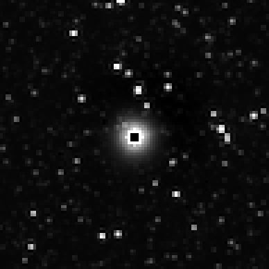
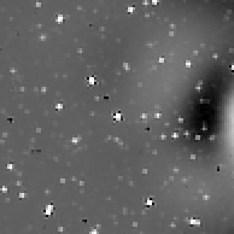
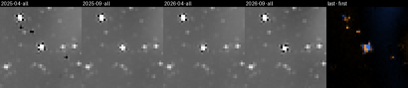

# SPHEREx Blink

A web tool for blinking NASA SPHEREx images: enter sky coordinates (RA/Dec) or an object name and get an animated
sequence of SPHEREx images of that sky patch, so moving and variable objects stand out.

Built for the NASA Space Apps Challenge 2026, challenge "Planet X and SPHEREx".

**Live site: <https://spherex-blink-web.victoriousmeadow-02021db7.polandcentral.azurecontainerapps.io/>**

<p align="center">
  
  &nbsp;
  
</p>
<p align="center"><em>Barnard's Star (left) and ε Indi B (right): visit stacks of all six detectors, one frame per
visit.</em></p>



*ε Indi B in four visits from 2025-04 to 2026-09, and the last − first difference: the blue/orange pair is the star
moving 6.7″ toward the south-east.*

All images are rendered by our pipeline from real SPHEREx data. None of them is AI-generated.

## Features

- **Search by name or position**: names resolve through SIMBAD, with the Harvard mirror as a fallback. Positions
  are entered as RA/Dec, with an optional proper motion. The field of view is 2–30′.
- **Comparable frames**: frames are per-visit stacks per detector, or all detectors combined. They are not raw
  single exposures at different wavelengths. Every frame is reprojected to one north-up grid at the native
  6.2″/px. Zodiacal light and the local background are subtracted, and every frame gets the same brightness
  stretch. Deep-field targets are split into 30-day bins.
- **Blink player**: play, pause and step through frames at 0.5–3 fps, or pick any two frames (A/B) to blink.
  Zoom in, switch detectors without a refetch, and choose an asinh, linear or log stretch.
- **Difference mode**: shows B − A on a diverging colour scale, so a moving star appears as a dark/bright pair.
- **Expected position**: a marker shows where a high-proper-motion target should be in each frame. The position
  is propagated with `SkyCoord.apply_space_motion`.
- **Gaia DR3 overlay**: Gaia stars propagated to each frame's epoch.
- **FLAGS overlay**: saturated, bad and artifact pixels are masked in the stacks and can be shown on top of the
  image. Saturated measurements are labelled "saturated" and never reported as numbers.
- **Data quality warnings**: a frame is marked when its wavelength coverage is incomplete, it has few
  exposures, or it is saturated.
- **Pixel readout and frame metadata**: click a pixel to read its value and flags. Each frame lists its dates,
  detectors, wavelength range and number of exposures.
- **Spectrum chart**: forced aperture photometry of the target per exposure, plotted as flux against wavelength
  and coloured by visit, with error bars. Saturated and masked points get hollow markers in a strip under the
  plot, never a value.
- **Light-curve chart**: flux against time per detector, with visit means, a χ² test against a constant
  brightness, and brightness changes measured at matched wavelength between visits.
- **Sky context**: Aladin Lite with 2MASS, AllWISE and DSS2 (from the IRSA HiPS mirror) and Gaia stars, centred on
  the target and matching the field of view.
- **Shareable views**: the whole view state lives in the URL (target, detector, frames, mode, stretch, overlays).
  A "Copy link" button copies it, and `/embed` shows a minimal player for iframes.
- **Works offline**: the five test targets ship as prebaked bundles of real SPHEREx data, so they open even
  without the backend or IRSA. A live search near a test target falls back to its bundle when the archive is
  down.
- **About page**: explains blinks, the dark/bright pairs of difference mode and the SPHEREx terms, with tooltips
  in the interface.

## Test targets

| Target | What it shows | Result (`science/VALIDATION.md`) |
|---|---|---|
| Barnard's Star | fastest proper motion | moves 1.65 px (10.3″) toward PA 359° in 1.1 yr |
| ε Indi B | nearby brown-dwarf binary | moves 1.07 px (6.7″) toward PA 129°; spectrum within 2–23 % of 2MASS J/H/Ks |
| WISE 0855−0714 | coldest known brown dwarf, at the detection limit | motion seen in D5–D6; the flux is blended with a field star and is an upper bound |
| RW Aurigae | T Tauri star, variable | 2.5× brightening at 0.75 µm (16.6σ); saturated in the other bands |
| R Draconis | Mira variable in the deep field | saturated in every exposure: shown as "saturated", not as numbers |

## Links and embedding

Every view is a URL: open a link and you get the same target, frames, mode and overlays. Parameters of the page:

| Parameter | Values | Default |
|---|---|---|
| `target` | test target: `barnard`, `eps_ind_b`, `wise0855`, `rw_aur`, `r_dra` | — |
| `name` | object name, resolved with SIMBAD | — |
| `ra`, `dec` | ICRS, decimal degrees or URL-encoded sexagesimal (`17 57 48.5`) | — |
| `pmra`, `pmdec`, `epoch` | proper motion in mas/yr (`pmra` includes cos δ) and the Julian year of `ra`/`dec`; draws the expected-position marker | from SIMBAD |
| `fov` | field of view, 2–30 arcmin | `10` |
| `det` | `all`, or detectors `1`–`6` as a comma list | `all` |
| `view` | `blink` or `diff` (difference B − A) | `blink` |
| `a`, `b` | frame ids, `v<visit>-<D1…D6 or all>`, e.g. `v1-all` | first, last |
| `fps` | 0.5–3 frames per second | `2` |
| `stretch` | `asinh`, `linear`, `log` | `asinh` |
| `flags` | overlay layers: `saturation`, `bad`, `artifact` (comma list) | none |
| `gaia` | `1` draws Gaia DR3 stars at each frame's epoch | off |

`target` wins over `name`, and `name` over `ra`/`dec`. Unknown parameters are ignored; an invalid value falls back to
the default with a notice on the page. Examples:

- Barnard's Star, difference of the first and last visit: [`/?target=barnard&view=diff`](https://spherex-blink-web.victoriousmeadow-02021db7.polandcentral.azurecontainerapps.io/?target=barnard&view=diff)
- ε Indi B in detector 3 only, with Gaia stars: [`/?target=eps_ind_b&det=3&gaia=1`](https://spherex-blink-web.victoriousmeadow-02021db7.polandcentral.azurecontainerapps.io/?target=eps_ind_b&det=3&gaia=1)

**Embedding.** `/embed` takes the same parameters and shows only the player, with a link to the full tool and its
limitations. Paste this into any HTML page:

```html
<iframe src="https://spherex-blink-web.victoriousmeadow-02021db7.polandcentral.azurecontainerapps.io/embed?target=eps_ind_b&view=diff&a=v1-all&b=v4-all"
        width="480" height="560" style="border:0" title="SPHEREx Blink: ε Indi B, 2026-09 minus 2025-04"></iframe>
```

## How it works

1. The backend finds SPHEREx exposures covering the position (IRSA SIA / TAP) and downloads small cutouts.
2. Exposures are grouped into visits and stacked per detector, reprojected to a common north-up grid and given
   one shared brightness stretch, so frames are directly comparable.
3. The frontend plays the stacks as a blink / flipbook, with a difference mode, the expected position of
   high-proper-motion targets, and a FLAGS (saturation / artifact) overlay. The view state is kept in the URL,
   so any view can be shared.

## Repository layout

| Path | Contents |
|---|---|
| `backend/` | Python 3.13 / FastAPI API: data discovery, cutouts, stacking |
| `frontend/` | React + TypeScript + Vite viewer, Aladin Lite sky context |
| `science/` | Test targets and validation scripts |
| `scripts/` | Mock and prebaked data bundles |
| `docs/` | API contract (`api.md`), challenge text, background research |

## Quick start

Requirements: [uv](https://docs.astral.sh/uv/) and Node.js 24 with npm. uv installs the pinned Python 3.13
(`backend/.python-version`) by itself.

```sh
cd backend && uv sync && uv run uvicorn app.main:app --reload --port 8000
cd frontend && npm ci && npm run dev
```

Open <http://localhost:5173>. The five test targets open from prebaked real SPHEREx data, also without the
backend; a search by name or coordinates asks the live archive through the backend.

### With Docker

Requirements: Docker with Compose v2.

```sh
docker compose up -d --build
```

Open <http://localhost:8080>. nginx serves the built frontend and the prebaked bundles and proxies `/api` and
`/files` to the backend, which is not published on the host. Downloaded and processed data live in the `cache`
volume (`docker compose down -v` removes it). Settings: copy `.env.example` to `.env`; no secrets are needed.
The port is bound to `127.0.0.1` unless `BIND_ADDR` says otherwise.

### CI/CD

Every pull request runs lint, type checks, tests, a Docker smoke test and secret/vulnerability scans
(`.github/workflows/ci.yml`). A green `main` is deployed to Azure Container Apps (`deploy.yml`, `infra/main.bicep`);
one-time setup in [`docs/deploy.md`](docs/deploy.md).

## Limitations

- **Can it find Planet X / Planet Nine? No.** The challenge is named after it, but this tool cannot find it, for
  two reasons. A Planet Nine–like body a few hundred AU away is 3–5 magnitudes fainter than a single SPHEREx image
  can see ([`docs/spherex-research.md`](docs/spherex-research.md)). And it would not creep across the field like a
  nearby star: as the Earth goes round the Sun, its position jumps by about 9′ (at 800 AU) to 23′ (at 300 AU)
  between SPHEREx visits half a year apart, which is 80–220 pixels, on top of its own motion of 9–40 pixels a year.
  A blink of one fixed patch of sky cannot link such jumps. The tool is built for what SPHEREx can show today:
  nearby stars and brown dwarfs that move 1–2 pixels over the year of data, and stars that change brightness. It
  makes no Planet X claims.
- SPHEREx pixels are 6.2″, so even the fastest nearby stars move only ~1–2 px over the available ~1 year baseline.
- Each detector covers a range of wavelengths that varies across the frame; frames are compared per detector,
  and incomplete wavelength coverage is reported.
- Faint targets near the detection limit are shown with their expected position and an upper limit, without
  claiming a detection.
- A live search uses at most 8 exposures per detector and visit (`LIVE_CAP_PER_DETECTOR`), so it takes ~2 min
  instead of ~5. Its frames are noisier and cover only part of each detector's wavelength range, which the frame
  details report, and its spectrum has about half the points. The five test targets are built from all exposures
  (up to 20 per detector and visit).

## Use of AI

- **Idea and decisions**: the team. The idea comes from the challenge statement. Scope, priorities, the science
  rules, data choices and hosting were decided by the team, not by AI.
- **Code, tests and documentation**: written with [Claude Code](https://claude.com/claude-code) (Anthropic), an AI
  coding assistant. Each of the four team members ran their own session for their part of the project (archive and
  API, frontend, science pipeline, charts and context). Team members gave the tasks, reviewed every pull request
  and merged it.
- **Research**: Claude Code also helped read the SPHEREx documentation and IRSA tutorials, probe the archive
  services, and summarise the background in `docs/spherex-research.md`.
- **Checking the results**: the science was checked against real data, not taken on trust. Measured proper motions
  and fluxes were compared with SIMBAD, Gaia DR3 and 2MASS catalogue values, and our spectrum of a field star with
  IRSA's own Spectrophotometry Tool (median ratio 0.998; `science/VALIDATION.md`), and each
  result was looked at by a person before it went into this README.
- **The running app uses no AI**: there are no AI calls at run time, and every image is computed from SPHEREx data.

## Data

**SPHEREx releases.** The backend asks IRSA's TAP service which SPHEREx collections exist and searches the newest
data release and the newest quick release, each with its wide and deep survey. Today that is **DR1**
(`spherex_dr1`, `spherex_dr1_deep`) and **QR3** (`spherex_qr3`, `spherex_qr3_deep`). A new release is picked up
without a code change; processed results are cached for 24 h.

**Reading from S3.** The pixels come from the public AWS bucket **`nasa-irsa-spherex`** (anonymous HTTPS,
us-east-1), which mirrors the IRSA file paths. A SPHEREx image file is 62 MB, and IRSA's cutout service returns
~4 MB per cutout whatever its size, because it always includes the full PSF extension. Instead, the backend reads
only the image rows that cover the field, with HTTP range requests: one range per request, since S3 answers a
multi-range request with the whole file. The pixels are identical to the cutout service's, and 8 parallel requests
take ~0.6 s per exposure. The cutout service needs 3–6 s per cutout at 2 parallel requests and answers `503` to many
requests at 3–4. If S3 fails, the backend falls back to IRSA's file server (up to 100 ranges per request) and then
to the cutout service.

**Other sources.** SPHEREx data: NASA / IPAC Infrared Science Archive (IRSA). Object names resolved with SIMBAD (CDS).
Star overlay: Gaia DR3 (ESA / Gaia DPAC), read from the MAST, GAVO or ESA archives.
Sky context: [Aladin Lite](https://aladin.cds.unistra.fr/AladinLite/) (CDS), with HiPS surveys from the IRSA mirror.

## Licence

SPHEREx Blink is free software under the GNU Lesser General Public License v3.0 ([`LICENSE`](LICENSE)), which
extends the GNU General Public License v3.0 ([`COPYING`](COPYING)). Aladin Lite, which the viewer uses, is
LGPL-3.0/GPL-3.0 as well. SPHEREx, Gaia, 2MASS, AllWISE and DSS2 data belong to their archives and are used under
their own terms.
