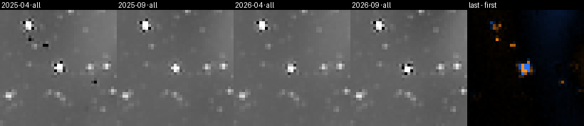

# Validation of the test targets

Generated by `science/validate.py` on 2026-11-14 18:18 UTC. Acceptance criteria: `docs/spec.md` §6.2.

## T-1 — Barnard's Star

Data: 338 cutouts (≤ 20 per detector and visit or bin), 3 visits/bins.

Catalog proper motion (SIMBAD): (-802, +10362) mas/yr.

| Frames | Epochs | Shift first→last | PA | Measured PM (mas/yr) | Δ/σ vs catalog | Criteria |
|---|---|---|---|---|---|---|
| D1 | 3 | 1.63 px (10.1″) | 4° | (+827, +10433) ± (3236, 687) | 0.5 | ✓ |
| D2 | 3 | 1.57 px (9.7″) | 1° | (+386, +9804) ± (2873, 24) | 23.7 | ✓ |
| D3 | 3 | 1.88 px (11.7″) | 360° | (+391, +11486) ± (3526, 1947) | 0.6 | ✓ |
| D4 | 3 | 1.48 px (9.1″) | 352° | (-1225, +9381) ± (1421, 1379) | 0.7 | ✓ |
| D5 | 3 | 1.67 px (10.3″) | 357° | (-394, +10485) ± (2186, 708) | 0.2 | ✓ |
| D6 | 3 | 1.65 px (10.2″) | 359° | (+20, +10390) ± (2201, 1003) | 0.4 | ✓ |
| all | 3 | 1.67 px (10.3″) | 359° | (-98, +10586) ± (1996, 1192) | 0.4 | ✓ |

Criteria (T-1): shift 1.3–2.3 px toward PA 356° ± 30° (docs/spec.md §6.2).

## T-2 — Epsilon Indi B (Ba/Bb)

Data: 364 cutouts (≤ 20 per detector and visit or bin), 4 visits/bins.

Catalog proper motion (SIMBAD): (+3982, -2467) mas/yr.

| Frames | Epochs | Shift first→last | PA | Measured PM (mas/yr) | Δ/σ vs catalog | Criteria |
|---|---|---|---|---|---|---|
| D1 | 3 | 0.21 px (1.3″) | 34° | (+840, +1059) ± (2894, 1694) | 2.1 | ✗ |
| D2 | 4 | 1.08 px (6.7″) | 129° | (+4075, -2884) ± (605, 302) | 1.4 | ✓ |
| D3 | 4 | 1.10 px (6.8″) | 129° | (+4060, -3069) ± (449, 268) | 2.2 | ✓ |
| D4 | 3 | 0.68 px (4.2″) | 125° | (+3529, -2423) ± (1086, 352) | 0.4 | ✗ |
| D5 | 4 | 1.03 px (6.4″) | 129° | (+3800, -2715) ± (436, 401) | 0.6 | ✓ |
| D6 | 4 | 1.02 px (6.3″) | 129° | (+3764, -2720) ± (422, 241) | 1.1 | ✓ |
| all | 4 | 1.07 px (6.6″) | 129° | (+3995, -2840) ± (469, 289) | 1.3 | ✓ |

Criteria (T-2): shift 0.7–1.5 px toward PA 122° ± 30° (docs/spec.md §6.2).

## FR-16 — spectrum of ε Indi B vs 2MASS

357 exposures measured by forced aperture photometry (r = 3 px) at the propagated position; 263 usable, 2 saturated.

| 2MASS band | 2MASS (mJy) | SPHEREx median in band (mJy) | Points | Ratio |
|---|---|---|---|---|
| J | 27.4 | 28.0 | 16 | 1.02 |
| H | 30.6 | 31.6 | 21 | 1.03 |
| Ks | 21.9 | 27.0 | 15 | 1.23 |

Acceptance (FR-16) asks for a ratio within 0.8–1.25 against IRSA's Spectrophotometry Tool; 2MASS (epoch 1999) is an independent sanity check, not that test. The SPHEREx points sample narrow LVF channels while 2MASS integrates the whole band, so deep T-dwarf absorption inside a band lowers the SPHEREx median.

## T-3 — WISE 0855-0714

Data: 244 cutouts (≤ 20 per detector and visit or bin), 3 visits/bins.

Forced aperture photometry (r = 3 px = 18.6″) at the position propagated from SIMBAD J2000 + proper motion (the challenge coordinates are epoch ≈2010.5).

| Wavelengths | Exposures | Flux (µJy) | S/N |
|---|---|---|---|
| λ < 1.6 µm (D1–D2) | 77 | 957 ± 12 | 82.8 |
| 1.6–3.8 µm (D3–D4) | 80 | 414 ± 8 | 49.9 |
| λ ≥ 3.8 µm (D5–D6) | 87 | 412 ± 26 | 16.0 |

| Frames | Measured shift | Expected shift (proper motion) |
|---|---|---|
| D5 | 0.90 px @ PA 276° | 1.30 px @ PA 275° |
| D6 | 1.05 px @ PA 277° | 1.29 px @ PA 275° |
| all | 0.01 px @ PA 235° | 1.29 px @ PA 275° |

**Motion of WISE 0855 detected** in D5 and D6: the source shifts in the predicted direction where WISE 0855 is bright and the field source is faint.

**The flux is contaminated**: 957 µJy at λ < 1.6 µm (S/N 83) can only come from a field source in the aperture, so 412 ± 26 µJy at λ ≥ 3.8 µm is an upper bound for WISE 0855, not its flux. The blend also shortens the measured shift.

For reference, WISE W2 = 14.0 corresponds to ≈ 432 µJy at 4.6 µm.

## T-4 — RW Aurigae

Data: 180 cutouts (≤ 10 per detector and visit or bin), 3 visits/bins.

178 exposures measured; 161 saturated (reported as saturated, no flux). T Tauri star with irregular dimming.

| Detector | Visits with flux | Min (mJy) | Max (mJy) | Max/min | Significance (σ) | Saturated points |
|---|---|---|---|---|---|---|
| D1 | 3 | 119.51 | 182.46 | 1.53 | 126 | 19 |
| D2 | 0 | — | — | — | — | 28 |
| D3 | 0 | — | — | — | — | 27 |
| D4 | 0 | — | — | — | — | 27 |
| D5 | 0 | — | — | — | — | 30 |
| D6 | 0 | — | — | — | — | 30 |

Fluxes are per detector, averaged over each visit's exposures; the LVF wavelength differs between exposures, so changes in λ coverage between visits add to the apparent variability.

Matched λ: each exposure is paired with the nearest-λ exposure of another visit (≤ 1 LVF channel apart); errors include a 5 % floor per exposure and the local spectral slope times the λ offset. The strongest visit pair per detector (the largest of several looks, so judge it against 5σ):

| Detector | Visits | Later / earlier | Significance (σ) | Pairs | λ (µm) |
|---|---|---|---|---|---|
| D1 | 2025-09 → 2026-09 | 2.43 | 12.5 | 1 | 0.764–0.764 |

## T-5 — R Draconis

Data: 132 cutouts (≤ 3 per detector and visit or bin), 17 visits/bins.

128 exposures measured; 128 saturated (reported as saturated, no flux). Mira variable in the deep field; 30-day bins.

| Detector | Visits with flux | Min (mJy) | Max (mJy) | Max/min | Significance (σ) | Saturated points |
|---|---|---|---|---|---|---|
| D1 | 0 | — | — | — | — | 25 |
| D2 | 0 | — | — | — | — | 15 |
| D3 | 0 | — | — | — | — | 24 |
| D4 | 0 | — | — | — | — | 26 |
| D5 | 0 | — | — | — | — | 15 |
| D6 | 0 | — | — | — | — | 23 |

Fluxes are per detector, averaged over each visit's exposures; the LVF wavelength differs between exposures, so changes in λ coverage between visits add to the apparent variability.

Matched λ: no comparison — no two visits have measured (unsaturated, unmasked) exposures within one LVF channel.

## Caveats

- Positions come from a 2D Gaussian fit with masked pixels excluded (Barnard's saturated core is left out).
  Flux-weighted centroids lock onto pixel centres of the undersampled PSF and shortened the shifts by 10-20 %.
- Proper-motion errors come from the scatter of 3–4 epochs around a line; parallax (0.27–0.55″) is ignored
  (SR-3) and contributes to that scatter. With 3 epochs the error rests on one degree of freedom and can be
  accidentally tiny (Barnard D2: σ = 24 mas/yr → Δ/σ = 24 although the shift and PA agree); trust the 4-epoch
  ε Indi B errors more.
- ε Indi B D4 misses the last visit (no D4 exposures in it), so its first→last baseline and shift are shorter;
  the 0.7 px threshold assumes the full baseline.
- ε Indi A (V 4.7) lies 6.7′ west of ε Indi B: its halo leaves residuals at the western edge of the difference.
- D1 (0.75–1.1 µm) barely detects the T dwarfs ε Indi Ba/Bb, so its shift is noise-dominated.
- Photometry uses the pixel solid angle from the WCS; IRSA's per-pixel SAPM map would refine it by the small
  distortion term. Aperture r = 3 px without an aperture correction.
