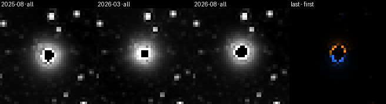

# Validation of the test targets

Generated by `science/validate.py` on 2026-11-14 14:03 UTC. Acceptance criteria: `docs/spec.md` §6.2. Status: **draft** — motion targets only (T-1, T-2); T-3 … T-5 follow.

## T-1 — Barnard's Star

Sample: 72 cutouts (≤ 4 per detector and visit), 3 visits. Catalog PM (SIMBAD): (-802, +10362) mas/yr.

| Frames | Epochs | Shift first→last | PA | Measured PM (mas/yr) | Δ/σ vs catalog | Criteria |
|---|---|---|---|---|---|---|
| D1 | 3 | 1.61 px (10.0″) | 2° | (+479, +10288) ± (4960, 822) | 0.3 | ✓ |
| D2 | 3 | 1.59 px (9.9″) | 4° | (+928, +9843) ± (4377, 796) | 0.7 | ✓ |
| D3 | 3 | 1.96 px (12.1″) | 358° | (+56, +12173) ± (3261, 1622) | 1.1 | ✓ |
| D4 | 3 | 1.63 px (10.1″) | 351° | (-1656, +10310) ± (928, 516) | 0.9 | ✓ |
| D5 | 3 | 1.68 px (10.4″) | 359° | (-147, +10379) ± (1614, 361) | 0.4 | ✓ |
| D6 | 3 | 1.66 px (10.3″) | 354° | (-714, +10209) ± (2308, 1006) | 0.2 | ✓ |
| all | 3 | 1.60 px (9.9″) | 353° | (-1051, +9998) ± (2338, 1569) | 0.2 | ✓ |

Criteria (T-1): shift 1.3–2.3 px toward PA 356° ± 30° (docs/spec.md §6.2).

## T-2 — Epsilon Indi B (Ba/Bb)

Sample: 88 cutouts (≤ 4 per detector and visit), 4 visits. Catalog PM (SIMBAD): (+3982, -2467) mas/yr.

| Frames | Epochs | Shift first→last | PA | Measured PM (mas/yr) | Δ/σ vs catalog | Criteria |
|---|---|---|---|---|---|---|
| D1 | 3 | 0.22 px (1.4″) | 47° | (+1087, +899) ± (3126, 1330) | 2.5 | ✗ |
| D2 | 4 | 0.98 px (6.1″) | 132° | (+3708, -2727) ± (852, 518) | 0.5 | ✓ |
| D3 | 4 | 1.02 px (6.3″) | 125° | (+4105, -2785) ± (615, 386) | 0.8 | ✓ |
| D4 | 3 | 0.72 px (4.5″) | 126° | (+3672, -2614) ± (1229, 357) | 0.4 | ✓ |
| D5 | 4 | 1.02 px (6.3″) | 129° | (+3813, -2661) ± (432, 434) | 0.4 | ✓ |
| D6 | 4 | 1.00 px (6.2″) | 129° | (+3698, -2809) ± (403, 189) | 1.8 | ✓ |
| all | 4 | 1.05 px (6.5″) | 129° | (+3929, -2813) ± (589, 247) | 1.4 | ✓ |

Criteria (T-2): shift 0.7–1.5 px toward PA 122° ± 30° (docs/spec.md §6.2).

## Caveats

- Development sample, not full depth: λ coverage per visit is partial, so some frames carry "incomplete λ
  coverage" warnings. Numbers will be refreshed from the full-depth prebake.
- Positions come from a 2D Gaussian fit with masked pixels excluded (Barnard's saturated core is left out).
  Flux-weighted centroids lock onto pixel centres of the undersampled PSF and shortened the shifts by 10-20 %.
- Proper-motion errors come from the scatter of 3–4 epochs around a line; parallax (0.27–0.55″) is ignored
  (SR-3) and contributes to that scatter, so Δ/σ can exceed 3 even when the motion is clearly right.
- ε Indi A (V 4.7) lies 6.7′ west of ε Indi B: its halo leaves residuals at the western edge of the difference.
- D1 (0.75–1.1 µm) barely detects the T dwarfs ε Indi Ba/Bb, so its shift is noise-dominated.
